# Домашнее задание к занятию «Хранение в K8s»

Стенд: Oracle VirtualBox VM (Ubuntu 24.04.4 LTS), MicroK8s **v1.35.6** (один узел `vladspace-virtualbox`),
`kubectl` **v1.37.1**. Namespaced-объекты лежат в namespace **`storage-hw`** (в командах `-n storage-hw`),
а PersistentVolume и StorageClass — кластерные, namespace у них нет. Данные томов лежат на диске самой VM, которая
в MicroK8s и есть узел: `/mnt/data/pv-demo` (задание 2) и `/mnt/disks/sc-demo` (задание 3).

| Файл | Объекты | Задание |
|---|---|---|
| [`containers-data-exchange.yaml`](manifests/containers-data-exchange.yaml) | Deployment `data-exchange` (busybox + multitool, `emptyDir`) | 1 |
| [`pv-pvc.yaml`](manifests/pv-pvc.yaml) | PV `pv-demo`, PVC `data-pvc`, Deployment `data-exchange-pvc` | 2 |
| [`sc.yaml`](manifests/sc.yaml) | StorageClass `local-sc`, PVC `data-sc-pvc`, Deployment `data-exchange-sc` | 3 |
| [`pv-local.yaml`](manifests/pv-local.yaml) | PV `pv-local` (этого PV нет в шаблоне, см. п. 3.2) | 3 |

Сырые логи команд — в [`logs/`](logs/), скриншоты — в [`img/`](img/).

## Где шаблоны из задания пришлось исправить

1. **Запись «каждые 5 секунд».** В шаблоне busybox делает `echo $(date) > файл; sleep 3600`: это **одна** запись, да ещё
   с перезаписью файла (`>`). Я заменил это циклом `while true; do ... >> файл; sleep 5; done` — с дозаписью.
2. **Читатель — multitool, а не busybox.** В шаблоне оба контейнера busybox, а по условию читает multitool. Он остался
   с запуском по умолчанию, том у него смонтирован `readOnly: true`, а файл я читаю командой `tail -f`, запущенной в
   контейнере через `kubectl exec` (в шаблоне `tail -f` — основной процесс второго контейнера).
3. **Образы** закреплены: `busybox:1.36`, `wbitt/network-multitool:3.24.4` (в шаблоне `busybox` без тега).
4. **PVC:** добавлен `storageClassName: ""`. Если в кластере появится StorageClass по умолчанию, PVC без этого поля
   получил бы именно его и перестал бы подходить к PV без класса. **PV:** добавлен `hostPath.type: DirectoryOrCreate`,
   чтобы каталог на узле создавался сам.
5. **В `sc.yaml` из шаблона нет PV**, а класс `kubernetes.io/no-provisioner` тома сам не создаёт, поэтому PVC с этим
   шаблоном зависает навсегда. Это показано в п. 3.1. Недостающий PV вынесен в отдельный файл
   [`pv-local.yaml`](manifests/pv-local.yaml).

## Задание 1. Volume: обмен данными между контейнерами Pod'а

### 1.1. Манифест

[`manifests/containers-data-exchange.yaml`](manifests/containers-data-exchange.yaml): два контейнера, общий том
`emptyDir`, busybox пишет, multitool читает.

```yaml
apiVersion: apps/v1
kind: Deployment
metadata:
  name: data-exchange
spec:
  replicas: 1
  selector:
    matchLabels:
      app: data-exchange
  template:
    metadata:
      labels:
        app: data-exchange
    spec:
      containers:
        - name: busybox
          image: busybox:1.36
          command: ["/bin/sh", "-c"]
          # каждые 5 секунд дописываем строку с временем в общий файл (>> дозаписывает, > затирала бы файл)
          args:
            - |
              while true; do
                echo "$(date '+%F %T') line from busybox" >> /data/out.txt
                sleep 5
              done
          volumeMounts:
            - name: shared-data
              mountPath: /data
        - name: multitool
          image: wbitt/network-multitool:3.24.4
          # читатель: тот же каталог, смонтированный только на чтение
          volumeMounts:
            - name: shared-data
              mountPath: /data
              readOnly: true
      volumes:
        - name: shared-data
          emptyDir: {} # живёт, пока жив Pod, и общий для всех его контейнеров
```

```bash
kubectl create namespace storage-hw
kubectl apply -n storage-hw -f manifests/containers-data-exchange.yaml
kubectl rollout status deployment/data-exchange -n storage-hw --timeout=180s
kubectl get pods -n storage-hw
```

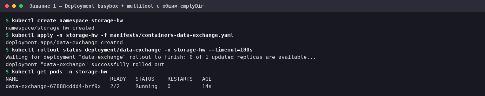

### 1.2. Описание Pod'а

```bash
kubectl describe pods data-exchange -n storage-hw
```

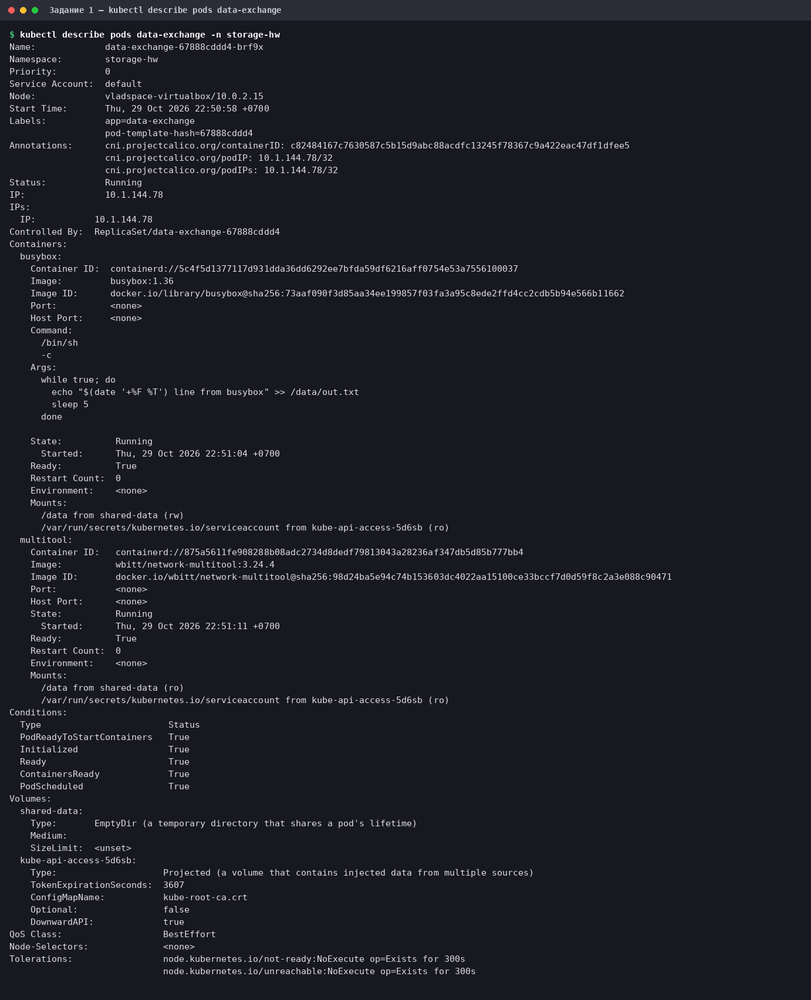

В `describe` видно главное: у контейнера `busybox` том `shared-data` смонтирован в `/data` с правами **`(rw)`**, у
контейнера `multitool` — туда же с правами **`(ro)`**, а сам том имеет тип
`EmptyDir (a temporary directory that shares a pod's lifetime)`.

### 1.3. Чтение файла из multitool

```bash
kubectl exec -n storage-hw deploy/data-exchange -c multitool -- ls -l /data
kubectl exec -n storage-hw deploy/data-exchange -c multitool -- timeout 13 tail -f /data/out.txt
kubectl exec -n storage-hw deploy/data-exchange -c multitool -- sh -c "echo test >> /data/out.txt"
```

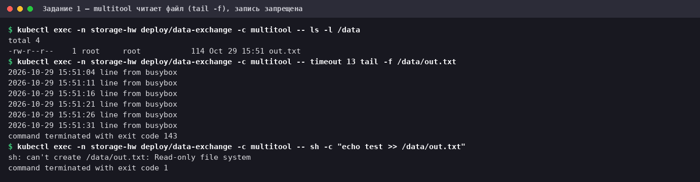

`tail -f` в контейнере multitool показывает строки, которые дописывает busybox. `timeout 13` нужен только затем, чтобы
бесконечный `tail -f` завершился сам (код 143 — это `timeout`, а не ошибка). Третья команда подтверждает, что multitool
именно читает: запись из него отклоняется (`Read-only file system`).

### 1.4. Как долго живёт `emptyDir`

```bash
kubectl exec -n storage-hw deploy/data-exchange -c multitool -- head -1 /data/out.txt
kubectl delete pod -n storage-hw -l app=data-exchange
kubectl wait -n storage-hw --for=condition=Ready pod -l app=data-exchange --timeout=120s
kubectl exec -n storage-hw deploy/data-exchange -c multitool -- head -1 /data/out.txt
kubectl exec -n storage-hw deploy/data-exchange -c multitool -- wc -l /data/out.txt
```

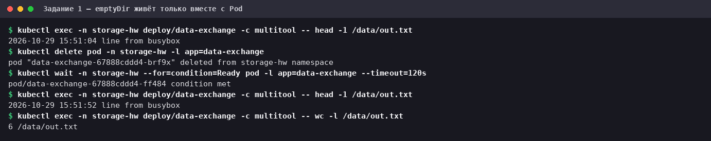

После пересоздания Pod'а файл начался заново: первая строка сменилась с `15:51:04` на `15:51:52`, и в нём всего 6 строк.
`emptyDir` создаётся вместе с Pod'ом и удаляется вместе с ним, это не постоянное хранилище. Для данных, которые должны
пережить Pod, и нужны PV и PVC (задания 2 и 3). Deployment задания 1 после этого удалён, чтобы не мешать следующим.

## Задание 2. PV и PVC

### 2.1. Манифест

[`manifests/pv-pvc.yaml`](manifests/pv-pvc.yaml): PV на каталог узла, PVC, привязанный к нему по имени, и Deployment,
который монтирует этот PVC:

```yaml
---
apiVersion: v1
kind: PersistentVolume
metadata:
  name: pv-demo
spec:
  capacity:
    storage: 1Gi
  volumeMode: Filesystem
  accessModes:
    - ReadWriteOnce
  # Retain: при удалении PVC том и данные сохраняются, PV переходит в Released
  persistentVolumeReclaimPolicy: Retain
  hostPath:
    path: /mnt/data/pv-demo
    # без type kubelet ничего не проверяет и не создаёт; DirectoryOrCreate создаст каталог на узле
    type: DirectoryOrCreate
---
apiVersion: v1
kind: PersistentVolumeClaim
metadata:
  name: data-pvc
spec:
  # привязка к конкретному PV по имени
  volumeName: pv-demo
  # пустой класс явно: PVC не должен получить StorageClass по умолчанию (если он появится в кластере)
  storageClassName: ""
  volumeMode: Filesystem
  accessModes:
    - ReadWriteOnce
  resources:
    requests:
      storage: 1Gi
---
apiVersion: apps/v1
kind: Deployment
metadata:
  name: data-exchange-pvc
spec:
  replicas: 1
  selector:
    matchLabels:
      app: data-exchange-pvc
  template:
    metadata:
      labels:
        app: data-exchange-pvc
    spec:
      containers:
        - name: busybox
          image: busybox:1.36
          command: ["/bin/sh", "-c"]
          args:
            - |
              while true; do
                echo "$(date '+%F %T') line from busybox (PV)" >> /data/out.txt
                sleep 5
              done
          volumeMounts:
            - name: pv-storage
              mountPath: /data
        - name: multitool
          image: wbitt/network-multitool:3.24.4
          volumeMounts:
            - name: pv-storage
              mountPath: /data
              readOnly: true
      volumes:
        - name: pv-storage
          persistentVolumeClaim:
            claimName: data-pvc
```

### 2.2. Создание PV, PVC и Deployment

```bash
kubectl apply -n storage-hw -f manifests/pv-pvc.yaml
kubectl get pv,pvc -n storage-hw
kubectl describe pv pv-demo
kubectl rollout status deployment/data-exchange-pvc -n storage-hw --timeout=180s
kubectl get pods -n storage-hw
kubectl get pv,pvc -n storage-hw
```

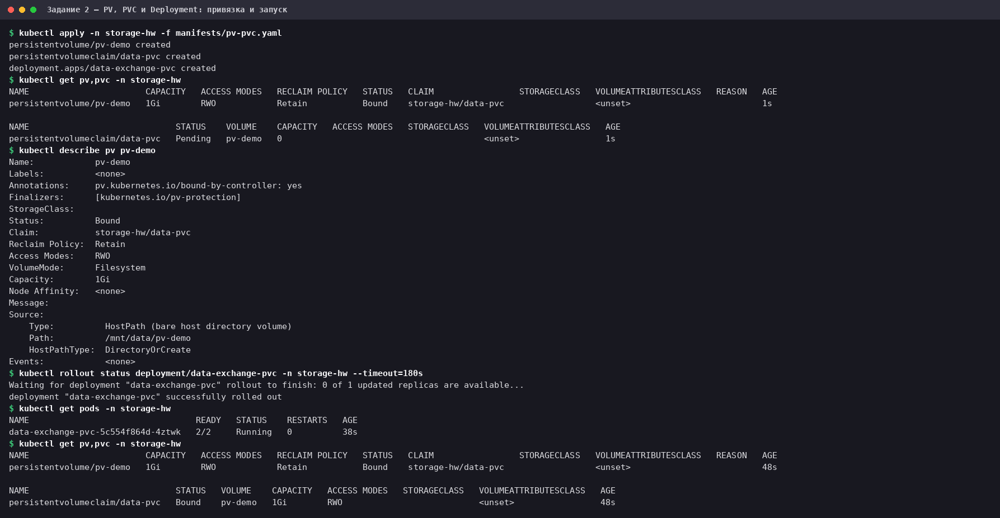

Первый `get pv,pvc` сделан через секунду после `apply`: PV уже `Bound`, а PVC ещё показывает `Pending` — статус claim'а
просто не успел обновиться. Второй `get` в конце: оба объекта `Bound`, PV ссылается на `storage-hw/data-pvc`. В
`describe pv` — тип `HostPath`, путь `/mnt/data/pv-demo`, политика `Retain`, статус `Bound`.

### 2.3. multitool читает данные из PV

```bash
kubectl exec -n storage-hw deploy/data-exchange-pvc -c multitool -- timeout 13 tail -f /data/out.txt
ls -l /mnt/data/pv-demo
```

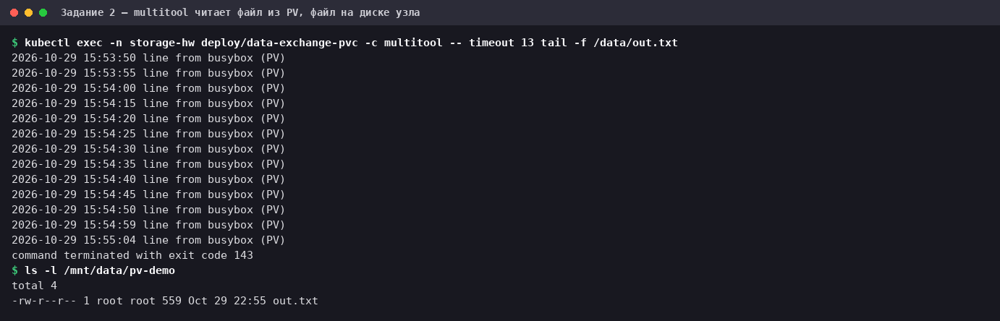

multitool читает файл, в который пишет busybox. Тот же файл `out.txt` виден **прямо на диске узла**, в каталоге
`/mnt/data/pv-demo`: `hostPath` просто показывает контейнерам каталог хоста.

### 2.4. Удаление Deployment и PVC: что стало с PV

```bash
kubectl delete deployment data-exchange-pvc -n storage-hw
kubectl delete pvc data-pvc -n storage-hw
kubectl get pv,pvc,pods -n storage-hw
kubectl describe pv pv-demo
```

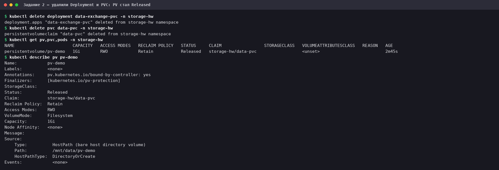

PV **не исчез** и перешёл из `Bound` в **`Released`**. В `describe pv` по-прежнему указан `Claim: storage-hw/data-pvc`
(такого PVC уже нет), а `Reclaim Policy: Retain`.

**Почему.** Это прямое следствие политики `persistentVolumeReclaimPolicy: Retain`, которую я задал в манифесте PV. Она
говорит кластеру: когда PVC удалён, сам том и его данные не трогать, их судьбу решает администратор. Поэтому PV не
удаляется и не очищается, а получает статус `Released`: «claim удалён, но ресурс ещё не восстановлен администратором».
Ссылка на старый claim при этом остаётся на месте. Так сделано намеренно: том содержит данные прежнего владельца, и
кластер не отдаёт его автоматически новому PVC. Чтобы использовать такой PV снова, администратору нужно решить, что
делать с данными, и убрать эту ссылку (`claimRef`) либо создать PV заново. Повторную привязку к новому PVC я не
проверял, это следует из документации Kubernetes. Была бы политика `Delete`, том вёл бы себя иначе: он удалялся бы
вместе с PVC.

### 2.5. Файл на диске узла и удаление PV

```bash
ls -l /mnt/data/pv-demo
wc -l /mnt/data/pv-demo/out.txt
tail -n 3 /mnt/data/pv-demo/out.txt
date '+%F %T'
```

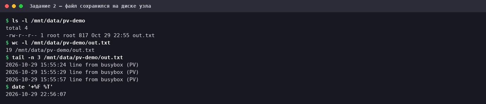

Файл сохранился: `out.txt`, 19 строк, 817 байт, права `root:root` (его создал busybox, работающий в контейнере от
root). Последняя строка записана примерно за 10 секунд до замера `date`, то есть после удаления Deployment запись
прекратилась. Контейнеры пишут время по UTC (`15:55`), а `date` на VM показывает местное UTC+7 (`22:56`): разница ровно 7
часов, не расхождение.

```bash
kubectl delete pv pv-demo
kubectl get pv
ls -l /mnt/data/pv-demo
tail -n 2 /mnt/data/pv-demo/out.txt
```

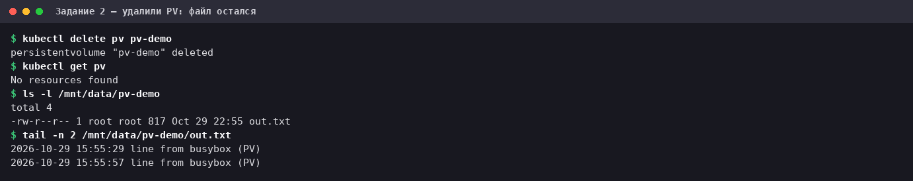

PV удалён (`No resources found`), а файл **остался на месте**, с тем же размером 817 байт и теми же последними строками.

**Почему.** PersistentVolume в Kubernetes — это запись в API о том, где лежат данные и как ими пользоваться, а не сами
данные. Удаление PV стирает эту запись, а каталог `/mnt/data/pv-demo` на диске узла Kubernetes не принадлежит. Для
`hostPath` и политики `Retain` кластер вообще не трогает содержимое: за очистку отвечает администратор. Более того, по
документации Kubernetes для `hostPath` не реализовано автоматическое удаление данных (поддерживается только устаревшая
политика `Recycle`), так что и с `Delete` файлы остались бы. Это я не проверял. Поэтому данные на узле нужно убирать
вручную, и после этого ДЗ я их тоже не удалял сам (см. «Как убрать»).

## Задание 3. StorageClass

### 3.1. `sc.yaml` из шаблона: PVC зависает в Pending

[`manifests/sc.yaml`](manifests/sc.yaml): StorageClass, PVC на его основе и Deployment, который его монтирует:

```yaml
---
apiVersion: storage.k8s.io/v1
kind: StorageClass
metadata:
  name: local-sc
# no-provisioner: тома автоматически не создаются, PV для этого класса готовит администратор вручную
provisioner: kubernetes.io/no-provisioner
# привязка PVC к PV откладывается до появления Pod'а, которому том нужен (ему выбирается узел)
volumeBindingMode: WaitForFirstConsumer
---
apiVersion: v1
kind: PersistentVolumeClaim
metadata:
  name: data-sc-pvc
spec:
  volumeMode: Filesystem
  accessModes:
    - ReadWriteOnce
  resources:
    requests:
      storage: 1Gi
  storageClassName: local-sc
---
apiVersion: apps/v1
kind: Deployment
metadata:
  name: data-exchange-sc
spec:
  replicas: 1
  selector:
    matchLabels:
      app: data-exchange-sc
  template:
    metadata:
      labels:
        app: data-exchange-sc
    spec:
      containers:
        - name: busybox
          image: busybox:1.36
          command: ["/bin/sh", "-c"]
          args:
            - |
              while true; do
                echo "$(date '+%F %T') line from busybox (SC)" >> /data/out.txt
                sleep 5
              done
          volumeMounts:
            - name: sc-storage
              mountPath: /data
        - name: multitool
          image: wbitt/network-multitool:3.24.4
          volumeMounts:
            - name: sc-storage
              mountPath: /data
              readOnly: true
      volumes:
        - name: sc-storage
          persistentVolumeClaim:
            claimName: data-sc-pvc
```

Каталог для тома нужно подготовить заранее (подробности в п. 3.2), а затем применить `sc.yaml` **ровно как есть**:

```bash
sudo mkdir -p /mnt/disks/sc-demo && ls -ld /mnt/disks/sc-demo
kubectl apply -n storage-hw -f manifests/sc.yaml
sleep 20; kubectl get sc,pvc,pods -n storage-hw
kubectl describe pvc data-sc-pvc -n storage-hw | tail -5
kubectl describe pod -l app=data-exchange-sc -n storage-hw | tail -4
```

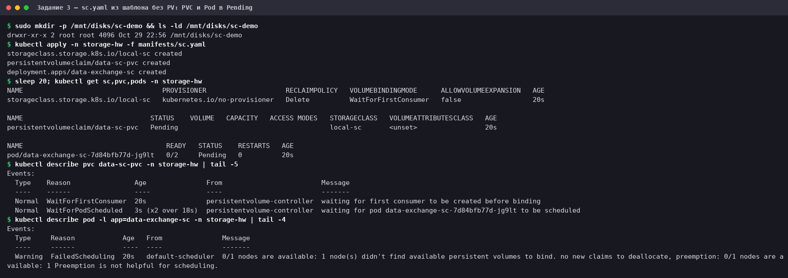

PVC и Pod остаются в **`Pending`**. События объясняют, в чём дело:

- PVC: `waiting for first consumer to be created before binding` и `waiting for pod ... to be scheduled`. Это работа
  `volumeBindingMode: WaitForFirstConsumer`: привязка откладывается, пока не станет известен узел Pod'а.
- Pod: `FailedScheduling: 0/1 nodes are available: 1 node(s) didn't find available persistent volumes to bind`.
  Планировщик не нашёл ни одного подходящего PV.

**Причина.** `provisioner: kubernetes.io/no-provisioner` означает «автоматического создания томов нет». PV для такого
класса готовит администратор вручную, а в шаблоне `sc.yaml` его нет. Без PV PVC не к чему привязываться, и Pod не
запустится никогда.

### 3.2. Добавляем PV

[`manifests/pv-local.yaml`](manifests/pv-local.yaml): PV того же класса `local-sc`, типа `local`, на каталог узла:

```yaml
# PV, которого нет в шаблоне sc.yaml, но без которого PVC класса local-sc не получит том:
# no-provisioner сам PV не создаёт.
apiVersion: v1
kind: PersistentVolume
metadata:
  name: pv-local
spec:
  capacity:
    storage: 1Gi
  volumeMode: Filesystem
  accessModes:
    - ReadWriteOnce
  persistentVolumeReclaimPolicy: Retain
  # PV относится к классу local-sc: только PVC с этим классом может на него встать
  storageClassName: local-sc
  # local-том физически лежит на одной ноде, поэтому nodeAffinity обязателен; каталог должен существовать заранее
  local:
    path: /mnt/disks/sc-demo
  nodeAffinity:
    required:
      nodeSelectorTerms:
        - matchExpressions:
            - key: kubernetes.io/hostname
              operator: In
              values:
                - vladspace-virtualbox
```

Здесь два отличия от `hostPath` из задания 2. Во-первых, у `local`-тома **обязателен `nodeAffinity`**: данные лежат на
конкретной ноде, и планировщик должен знать, на какую поставить Pod. Во-вторых, по документации kubelet не создаёт
каталог `local`-тома сам, поэтому я создал его заранее командой `sudo mkdir` (она в начале предыдущего лога).

```bash
kubectl apply -f manifests/pv-local.yaml
kubectl rollout status deployment/data-exchange-sc -n storage-hw --timeout=180s
kubectl get sc,pv,pvc,pods -n storage-hw
kubectl describe pv pv-local
```

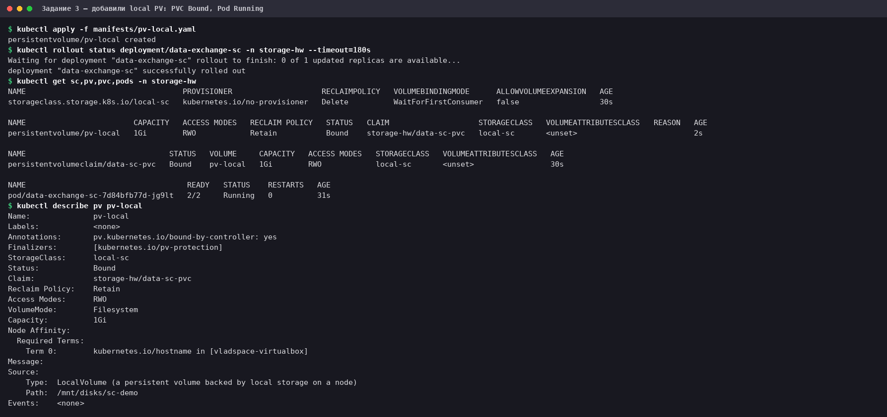

PV стал `Bound`, PVC `data-sc-pvc` — тоже `Bound` и ссылается на `pv-local`. **Тот самый** зависший Pod сам перешёл в
`2/2 Running`, пересоздавать ничего не пришлось: как только PV появился, привязка завершилась. В `describe pv` видны класс
`local-sc`, политика `Retain`, правило `kubernetes.io/hostname in [vladspace-virtualbox]` и тип `LocalVolume`.

В выводе `get sc` у `local-sc` стоит `RECLAIMPOLICY: Delete`: это значение по умолчанию для динамически создаваемых
томов. К нашему PV оно не относится, у него своя политика `Retain`, заданная в манифесте.

### 3.3. multitool читает данные

```bash
kubectl exec -n storage-hw deploy/data-exchange-sc -c multitool -- timeout 13 tail -f /data/out.txt
ls -l /mnt/disks/sc-demo
tail -n 2 /mnt/disks/sc-demo/out.txt
```

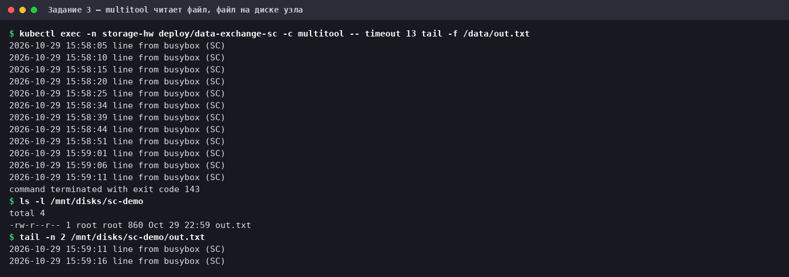

multitool читает файл, а тот же `out.txt` лежит на диске узла в `/mnt/disks/sc-demo`.

## Про паузы между записями

Условие — «запись каждые 5 секунд», и цикл в манифесте именно такой. Но в истории файлов на этой VM встречаются паузы
длиннее. По всему файлу на момент замера:

| Файл | Строк | Интервалы между записями, с |
|---|---|---|
| задание 1 (`emptyDir`) | 8 | 5 ×6, 7 ×1 |
| задание 2 (PV) | 19 | 5 ×15, 9, 15, 28 |
| задание 3 (SC) | 20 | 5 ×15, 7, 9, 10, 40 |

Основная часть интервалов — ровно 5 секунд. Причину пауз я не установил: загрузка VM в эти моменты была невысокой
(в простое около 90 %, `steal` и `iowait` нулевые), а отдельный замер `sleep 1` на самой VM опаздывал лишь 1 раз из
45 (на 0.53 с). Пропущенные записи не «теряются»: цикл просто не выполнялся. На обмен данными между контейнерами это не
влияет, но поэтому в выводе `tail -f` на скриншотах местами видны интервалы больше 5 секунд.

## Как повторить и убрать

```bash
kubectl create namespace storage-hw
kubectl apply -n storage-hw -f manifests/containers-data-exchange.yaml
kubectl apply -n storage-hw -f manifests/pv-pvc.yaml
sudo mkdir -p /mnt/disks/sc-demo
kubectl apply -n storage-hw -f manifests/sc.yaml -f manifests/pv-local.yaml

# удаление объектов Kubernetes
kubectl delete namespace storage-hw      # Deployment'ы и PVC
kubectl delete pv pv-local               # PV кластерный и вместе с namespace не удаляется
kubectl delete storageclass local-sc
# данные на диске узла Kubernetes не удаляет: их нужно убрать вручную
sudo rm -rf /mnt/data/pv-demo /mnt/disks/sc-demo
```

Ссылка для сдачи: файл `README.md` этого репозитория.
